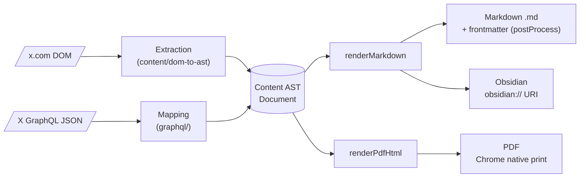
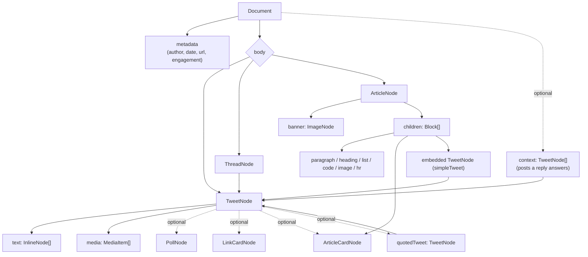
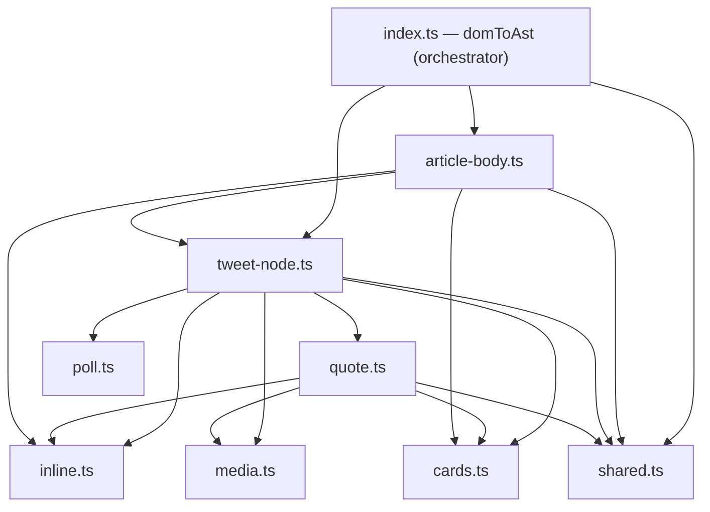
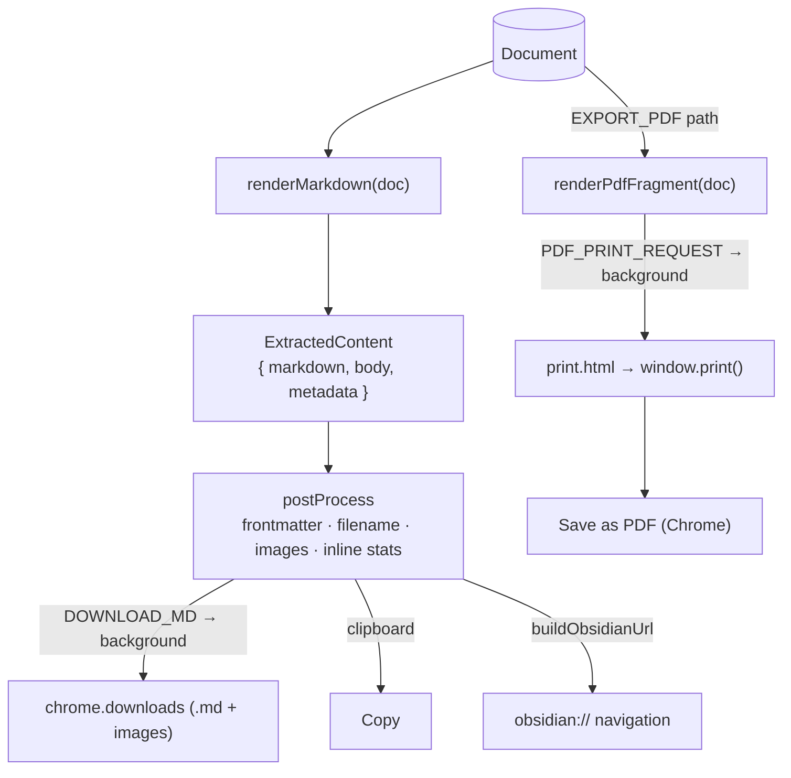
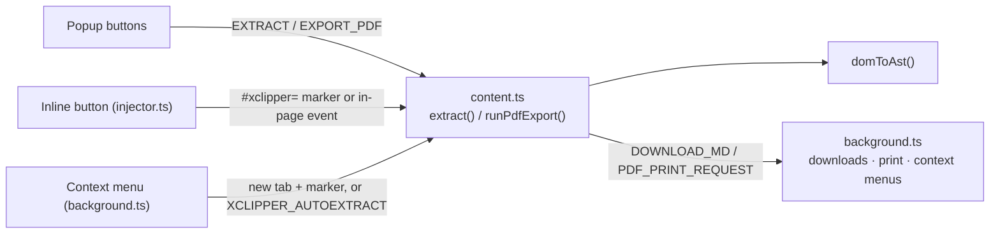
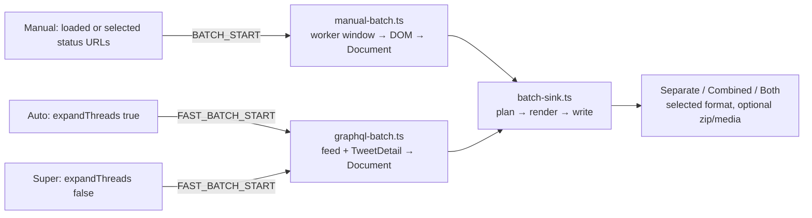

# XClipper architecture

A living overview of how XClipper turns x.com pages into Markdown, PDF, and
Obsidian notes — one item at a time or in batch. For the per-node AST contract
see [`ast-schema.md`](./ast-schema.md); for *why* the AST exists see
[`adr/0001`](./adr/0001-content-ast-architecture.md). Product terms are defined in
[`GLOSSARY.md`](../GLOSSARY.md); the batch navigation map below connects them to code.

## The one diagram

Both acquisition paths converge on **Content AST → renderers**: DOM acquisition
serves single exports and Manual batches; GraphQL acquisition serves Auto and
Super batches. The AST is the source of truth; renderers never touch the DOM.

Three planes, each independently testable:

| Plane | Lives in | Input → Output | Knows about |
|---|---|---|---|
| **Acquisition** | `content/dom-to-ast/`, `graphql/` | DOM `Element` or GraphQL JSON → `Document` | X's DOM or response shape |
| **Rendering** | `ast/` | `Document` → string (MD / HTML) | the AST only |
| **Orchestration** | `content/`, `popup/`, `background/` | user intent → message → file | Chrome APIs, settings |

The seam that makes scaling possible: `Document` is **JSON-serializable** and
already crosses the `chrome.runtime` message boundary inside `ExtractedContent`.
ASTs can be produced in one context, collected, and rendered in another.

## Content AST — node relationships

What gets extracted and how the nodes nest. Full field-level contract in
[`ast-schema.md`](./ast-schema.md).

Two recursions matter: a tweet can **quote** another tweet, and an article can
**embed** a full tweet. Both reuse `TweetNode`, so any renderer that handles a
tweet handles quotes and embeds for free.

## Extraction module map (`content/dom-to-ast/`)

A clean dependency DAG. The orchestrator (`index.ts`) and two composing nodes
(`tweet-node.ts`, `article-body.ts`) wire together the leaves — `inline`,
`cards`, `media`, `poll`, and the tiny `shared` helpers — none of which import
another `dom-to-ast` module. `quote.ts` sits between: it composes the leaves but
is itself only consumed by `tweet-node`. `articleToTweetNode` is the hub, used by
both the tweet path and, via `simpleTweet`, the article path.

`domToAst()` dispatches: article page → `articleDocument()`; otherwise it
collects the same-author run of `<article>` elements (the thread) and maps each
through `articleToTweetNode()`.

## Output pipelines

All outputs start from a `Document`. For single exports, the content script
renders Markdown; `postProcess` then shapes it per the user's settings. For all
batch engines, `background/batch-sink.ts` renders each acquired document using
the same renderers and post-processing rules.

- **Markdown / Copy / Obsidian** share the markdown plane. `postProcess` prepends
  YAML frontmatter (default or Obsidian-friendly schema, per-field toggles),
  resolves local images, and builds the filename. Obsidian just delivers that
  same markdown through an `obsidian://` URI instead of a file.
- **PDF** is a separate plane: AST → HTML fragment → handed to the background
  worker, which opens an extension-origin `print.html` and calls `window.print()`.
  It never touches markdown or `postProcess`. (See ADR 0001 → "Renderer decisions".)

## Orchestration & entry points

Three ways into a single export, one DOM extractor. Every single-post trigger
converges on `content.ts`; these automatic triggers are unrelated to the Auto
batch engine.

`background.ts` is the privileged hub: it owns the message route table (each
action with its trusted senders, checked by `router.ts` before the handler
runs), `chrome.downloads` (with path sanitization), the context menus, the PDF
print tab, and the one-time `tweet2md → xclipper` settings migration. `shared/`
holds logic both the popup and content script need (`post-process`, `settings`,
`media`, `obsidian`).

## Batch export: three engines, two acquisition paths

Export mode (Single / Batch), batch engine (Manual / Auto / Super), source, and
fetch mode are separate choices. Batch supports Markdown, TXT, HTML, JSON, and
CSV, with Separate / Combined / Both output; PDF remains a single-export format.

| Engine | Acquisition | Sources | Expansion and controls |
|---|---|---|---|
| **Manual** (default) | DOM in an unfocused worker window | Bookmarks, Profile, Likes, Timeline, Selection | Full threads/articles; determinate progress, pause/resume/stop |
| **Auto** (opt-in) | GraphQL feed + per-item TweetDetail | Bookmarks, Profile, Likes | Full threads/articles; open-ended counts and stop |
| **Super** (opt-in) | Same GraphQL path, `expandThreads: false` | Bookmarks, Profile, Likes | Skips self-thread expansion; still expands articles and replies to other authors; open-ended counts and stop |

Super can include an author's follow-up posts when expanding a reply to another
author. It is not a guarantee of one tweet per document. Auto/Super share one
implementation and require the optional `webRequest` permission, requested
through Chrome's own prompt when selected.

### Navigation map

| Responsibility | Current code | Contracts / verification |
|---|---|---|
| Single / Batch export mode | `src/popup/export-mode.ts` | `lastExportMode`; switching does not select an engine |
| Engine selection, permission prompt, fetch mode, GraphQL progress | `src/popup/batch-engine-ui.ts` | `BatchEngine`, `FetchMode`; Auto sends `expandThreads: true`, Super sends `false` |
| Source tabs, engine dispatch, Manual progress | `src/popup/batch-ui.ts` | Manual sends `BATCH_START`; Auto/Super send `FAST_BATCH_START` via `startGraphqlExport` |
| Manual acquisition and persisted job | `src/background/manual-batch.ts`, `batch-state.ts`, `src/content/content.ts` | `ManualBatch*` types, `BATCH_*` actions; `tests/manual-batch.test.ts`, `tests/batch-state.test.ts` |
| GraphQL acquisition for Auto/Super | `src/background/graphql-batch.ts`, `x-session.ts`, `src/graphql/` | `GraphqlBatch*` types, `FAST_BATCH_*` actions; `tests/graphql-batch.test.ts`, GraphQL mapper tests |
| Shared output and export history | `src/background/batch-sink.ts`, `src/shared/export-ledger.ts` | Every engine uses `planBatch`, `renderItem`, `itemFiles`, and the shared writers; sink/ledger tests |
| Message routing and trust | `src/types/messages.ts`, `src/background/background.ts`, `router.ts` | `tests/message-routes.test.ts` checks the action/trust table |

### Manual acquisition

The injector accumulates status permalinks as virtualized cells scroll through
the page (`XCLIPPER_HARVEST`); Selection supplies checked permalinks. The
background owns a sequential `ManualBatchJob`, persisted to
`chrome.storage.session`, and navigates one reused, unfocused worker window to
each permalink with `#xclipper=batch`. A visible window lets X render thread
continuations and lazy media. The content script extracts the DOM and reports a
`Document` via `BATCH_ITEM_RESULT`; the background renders and writes it.

The queue, watchdog, pause/resume, and restart policy belong to Manual. See
[`ADR 0002`](./adr/0002-batch-export-architecture.md) for their rationale.

### GraphQL acquisition

`x-session.ts` captures the user's existing X auth headers and request templates
with the optional permission and restores them from session storage after a
service-worker restart. `graphql-batch.ts` paginates the selected source,
maps feed JSON into the same `Document` AST, then uses TweetDetail for expansion.
Auto expands self-threads; Super skips them to allow a larger collection cap.
Both still fetch articles and replies to other authors, and both stop when X
rate-limits expansion. Incomplete items remain available for a later run.

Recent starts at the top of the feed. Resume uses a saved per-source backfill
cursor. Date range uses a separate continuation cursor keyed by its date window;
it does not move Resume's cursor. All fetch modes and engines share export
history through `src/shared/export-ledger.ts`; Reset history clears it and the
continuation cursors. See [`ADR 0003`](./adr/0003-fast-batch-graphql.md) for the
decisions and amendments.

### Compatibility names and historical terms

Active TypeScript names distinguish Manual from GraphQL acquisition. Existing
runtime identifiers keep their spelling so saved choices, jobs, and callers
continue to work:

- `BATCH_*` actions select/control Manual; `FAST_BATCH_*` select/control GraphQL.
  `expandThreads` and `paginate` remain the GraphQL request fields.
- `batchMode` stores the engine. Legacy `fastBatchMode` / `fastSuperMode` booleans
  still migrate on read. `fastPaginateMode`, `fastDateFrom`, and `fastDateTo`
  retain the fetch choice and date window. `lastExportMode` stores Single/Batch.
- `xclipper_batch_job`, `xclipper_batch_doc_*`, `xclipper-batch-watchdog`,
  `#xclipper=batch`, and the other single-export URL markers remain unchanged.
  Captured session data keeps `fastBatchAuth` / `fastBatchTemplates`; export
  ledgers, cursor keys, output folder names, and manifest permissions are unchanged.
- The DevTools helpers `xclipperStartBatch` / `xclipperFastBatch`, the popup
  event `xclipper-fast-changed`, and existing DOM/CSS hooks and locale keys retain
  their names. `XCLIPPER_AUTOEXTRACT` is a single-post trigger, not the Auto engine.

ADRs, release notes, and historical artifacts retain the language of their time:
**Standard** means today's Manual, **Fast Batch** names the shared GraphQL path,
and **Super Fast** means today's Super. ADR 0003's engine-selector amendment
records the transition; current navigation belongs here.
